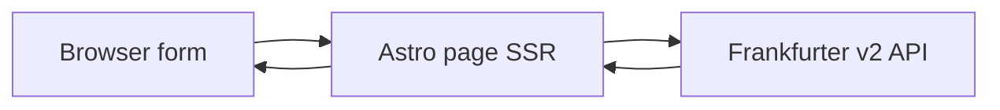

# fx-app: live currency converter (Astro)

## What you will get

A local Astro site: enter an amount, pick **from** and **to** currencies (USD, EUR, PHP, JPY, …), convert with **live rates**, and see the rate date plus the converted amount.

Rates come from [Frankfurter](https://frankfurter.dev/) (`https://api.frankfurter.dev`) — free, no API key, ~200 currencies.

**Framework change:** use **[Astro](https://astro.build/)** instead of Django/Flask. Astro is JavaScript/TypeScript, so this is a Node app, not a Python app.

## Project location

- Create and git-init at [`/Users/jonjavellana25/Projects/fx-app`](/Users/jonjavellana25/Projects/fx-app) via `create_project`.
- Immediately `move_agent_to_root` into that folder **before** any files or installs.
- If `~/Projects` cannot be used, fall back to `~/Developer/fx-app` then `~/fx-app`.

## Stack

- [Astro](https://astro.build/) + TypeScript, minimal template (no React/Vue unless needed)
- Server-rendered form on [`src/pages/index.astro`](src/pages/index.astro): on POST/GET, fetch `https://api.frankfurter.dev/v2/rate/{base}/{quote}` and `…/v2/currencies`
- [`@astrojs/node`](https://docs.astro.build/en/guides/integrations-guide/node/) so `astro dev` / `astro preview` can handle per-request conversion (not a static build-time snapshot)
- CSS in [`src/styles/global.css`](src/styles/global.css)
- Conversion math in TS with care for rounding (display with `Intl.NumberFormat`)

If you later choose **Astro + Django**, Astro would call a small Django JSON API instead of Frankfurter directly; that is two processes and is not the default.

## App behavior



- **Home (`/`):** amount, from/to dropdowns (currency list from Frankfurter), swap, Convert.
- **Convert:** amount × rate; show formatted money, rate, and rate date.
- **Errors:** invalid amount, unknown currency, or network failure on the same page.
- Defaults: from `USD` to `PHP`.

## Layout (after moving into the project)

- `package.json` — `astro`, `@astrojs/node`
- [`astro.config.mjs`](astro.config.mjs) — `output: 'server'`, Node adapter
- [`src/pages/index.astro`](src/pages/index.astro) — form + result
- [`src/lib/frankfurter.ts`](src/lib/frankfurter.ts) — fetch currencies and rate
- [`src/styles/global.css`](src/styles/global.css)
- [`README.md`](README.md) — Node version, `npm install`, `npm run dev`

## How you will run it

```bash
cd ~/Projects/fx-app
npm install
npm run dev
```

Open the URL Astro prints (usually `http://localhost:4321`). Needs internet when converting. Not for bank-grade accounting.

## Verification

Open the app in the browser, convert a known pair (e.g. 100 USD → EUR), confirm the result and validation / network error messaging.
